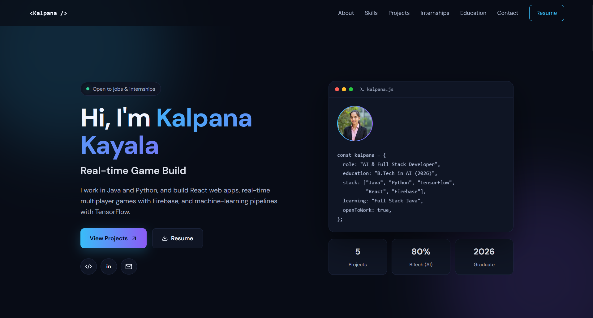
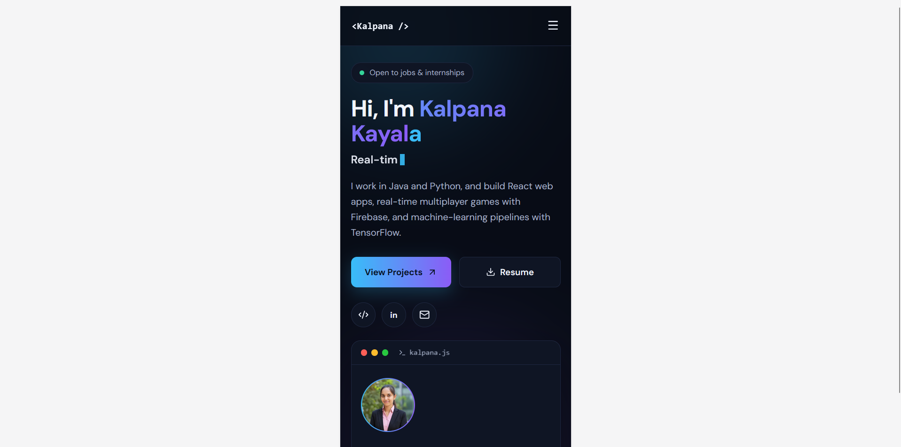

# ✨ Kalpana Kayala — Personal Portfolio

Welcome to my personal portfolio! This project showcases my skills, projects, and passion for building modern, responsive, and interactive web applications.

## 🚀 About the Project

A modern, animated developer portfolio built to present my technical skills, featured projects, and development journey in one place.
## 📸 Portfolio Preview

### Desktop View


### Mobile View


## 🛠️ Technologies Used

- React.js
- Vite
- JavaScript
- HTML5
- CSS3
- Framer Motion
- Lucide React

## 🌟 Features

- Modern dark-themed user interface
- Smooth animations and transitions
- Responsive design for desktop, tablet, and mobile
- Interactive project showcase
- Skills and technology sections
- Resume access
- Contact information

## 💻 Featured Projects

### 1. ShopSphere
A responsive mini e-commerce store.

[GitHub Repository](https://github.com/kalpana-57/ShopSphere) · [Live Demo](https://shopsphere-lilac.vercel.app)

### 2. FinTrack
A personal finance dashboard built with React and Recharts.

[GitHub Repository](https://github.com/kalpana-57/FinTrack)

### 3. Quiz Battle Arena
A real-time multiplayer quiz game built using JavaScript, Vite, and Firebase.

[GitHub Repository](https://github.com/kalpana-57/QuizBattleArena) · [Live Demo](https://quiz-battle-arena-eta.vercel.app)

### 4. Multimodal Chest X-ray Analysis
An AI-based medical imaging project focused on chest X-ray analysis and lung cancer detection.

## ⚙️ Run Locally

Clone the repository:

```bash
git clone https://github.com/kalpana-57/KalpanaPortfolio.git
```

Open the project folder:

```bash
cd KalpanaPortfolio
```

Install dependencies:

```bash
npm install
```

Start the development server:

```bash
npm run dev
```

Open the local URL displayed in your terminal.

## 📬 Connect With Me

- **GitHub:** https://github.com/kalpana-57
- **Email:** kalpanakayala75@gmail.com

---

⭐ Thank you for visiting my portfolio repository!
